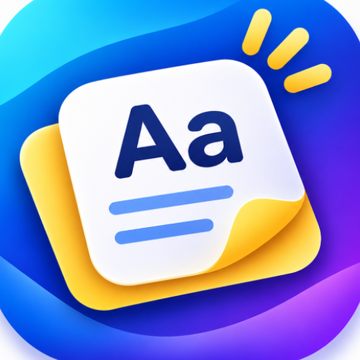

  

<h1 align="center">Phrasoteca</h1>

  <b>A personal collection of cards, phrases and notes — ready to read, flip or show.</b>

  
  
  
  
  

  <a href="#features">Features</a> ·
  <a href="#screenshots">Screenshots</a> ·
  <a href="#supported-languages">Languages</a> ·
  <a href="#privacy--data-storage">Privacy</a>

---

## Overview

Phrasoteca is an Android application for creating, organizing and using personal collections of cards, phrases and notes. It combines the simplicity of flashcards with the flexibility of a personal phrasebook and a quick-reference tool.

Designed for everyday communication, travel, language learning and personal information management, Phrasoteca lets you prepare useful information in advance and access it whenever you need it.

Unlike conventional flashcard applications focused primarily on memorization, Phrasoteca is designed around practical, everyday use: read a card, flip it to reveal additional information, listen to its pronunciation or show its contents to another person.

The application follows an offline-first approach and does not require a user account.

## Features

### Cards & Collections

- Create and manage personal collections of cards.
- Add, edit and delete cards and collections.
- Store phrases, translations, notes and other text-based information.
- Use two-sided cards for related pieces of information, such as a phrase and its translation.
- Flip cards to reveal their reverse side and navigate between cards.

### Presentation & Communication

- Display card content in a dedicated full-screen presentation mode.
- Use landscape orientation to show large, readable text to another person.
- Listen to card content using Android text-to-speech (TTS).
- Prepare frequently used phrases for real-world conversations.

### Security & Private Storage

- Organize private information in dedicated vault collections.
- Keep personal content on your device.

### Import, Export & Backup

- Import and export collection data in JSON format.
- Create backups and restore personal collections.
- Transfer collection data between devices without an online account.
- Reuse and share compatible JSON datasets.

### User Interface & Accessibility

- Light and dark themes.
- Multilingual user interface.
- Support for Android 10 and later.
- Access to locally stored cards without an internet connection.

### Ready-to-use Phrase Collections

The project also includes work on multilingual practical phrase datasets covering everyday communication and travel-related situations. These datasets are intended to provide a starting point for creating and customizing personal phrase collections, including regional language variants.

<!-- ## Screenshots -->

<!--

  
  
  

  
  
  

  

  
  

-->

## Use Cases

| Scenario | Example |
| --- | --- |
| Travel | Keep accommodation details, directions and frequently used phrases at hand. |
| Everyday communication | Show prepared messages to someone who speaks a different language. |
| Language learning | Create bilingual cards and listen to their pronunciation. |
| Personal notes | Organize useful information into thematic collections. |
| Education | Create study cards and quick-reference materials. |
| Professional use | Store technical references, instructions and frequently used text. |
| Private information | Organize personal notes in dedicated vault collections. |

## Supported Languages

Phrasoteca is designed with multilingual support for both the application interface and user-created content.

The interface localization covers English, Spanish, Portuguese, Russian, German and Chinese.

Cards are not restricted to the interface languages. Users can create their own multilingual collections, while compatible phrase datasets can contain regional language variants. Text-to-speech availability depends on the installed Android speech engine and its supported languages.

## Privacy & Data Storage

- Cards and collections are stored locally on the device using Room and SQLite.
- No user account is required for the core functionality.
- Core card and collection operations are available offline.
- Release builds integrate PostHog for application analytics; analytics are disabled in debug builds.
- Some text-to-speech engines may require an internet connection.

Users should handle exported backups carefully, especially when they contain personal information. An offline-first architecture does not mean that every component of the application operates without network access.

<!-- Add a link to PRIVACY.md once the privacy policy and actual analytics configuration have been reviewed. -->

## Technical Overview

| Component | Technology |
| --- | --- |
| Platform | Android |
| Programming language | Kotlin |
| Minimum Android version | Android 10 (API 29) |
| User interface | Android Views / XML layouts |
| Local database | Room / SQLite |
| Code generation | Kotlin Symbol Processing (KSP) |
| Build system | Gradle / Kotlin DSL |
| Data interchange | JSON |
| Speech synthesis | Android Text-to-Speech API |
| Application analytics | PostHog |
| Application ID | `com.paveltyapkin.phrasoteca` |

Phrasoteca is currently in alpha development. The public source code reflects an actively evolving application, and some features or interfaces may change in subsequent versions.

## About the Project

Phrasoteca originated from a practical need encountered while traveling in Brazil and Chile in 2026. Communicating in an unfamiliar language often meant repeatedly preparing the same phrases for everyday situations, such as speaking to a concierge, asking for assistance or explaining accommodation details.

The original idea was to create a simple tool for preparing frequently used phrases in advance and making them immediately available to read, flip or show, without repeatedly relying on translation applications.

Over time, this idea evolved into a more versatile application for organizing personal cards, phrases, notes and private information.

Developed by [Pavel Tyapkin](https://github.com/paveltyapkin).
